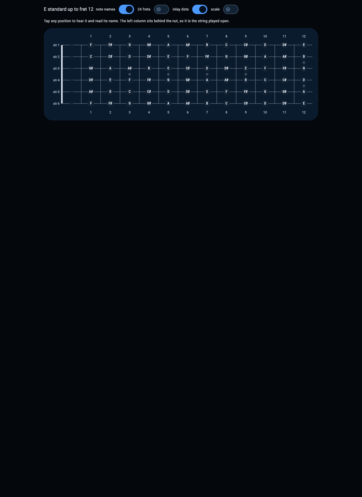
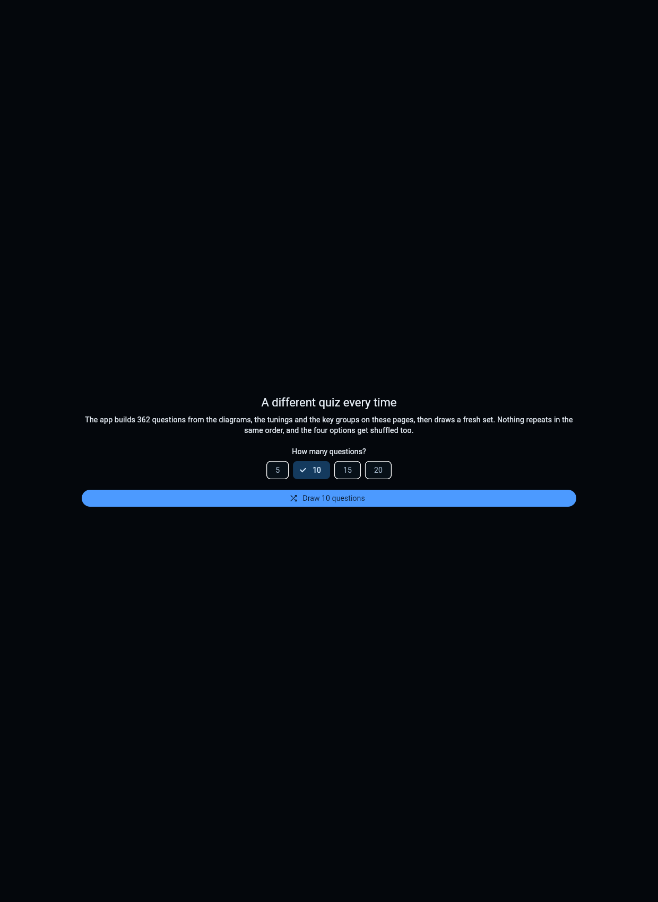
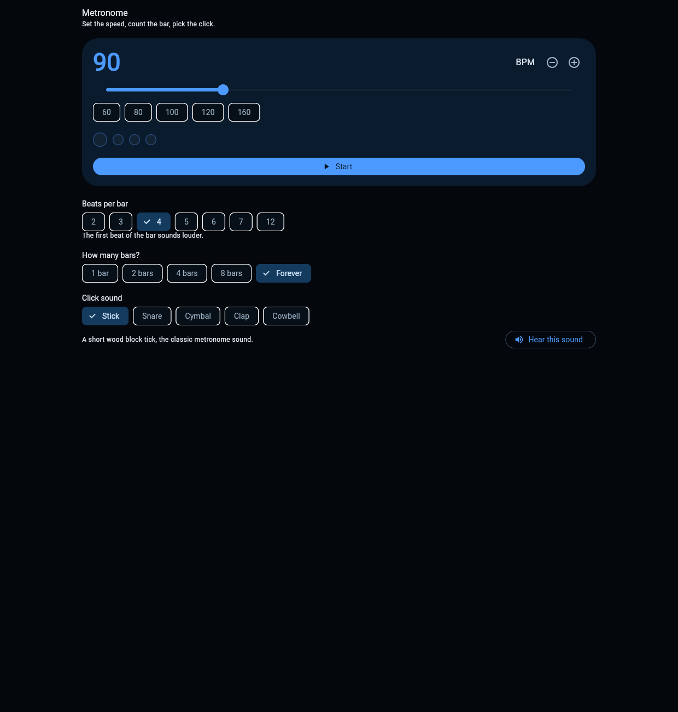
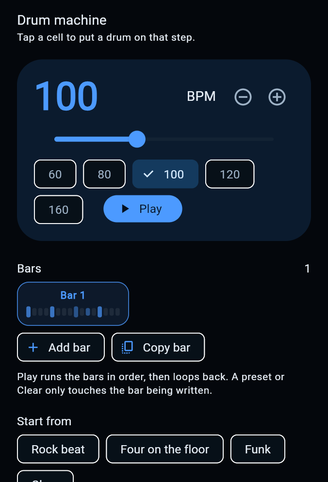
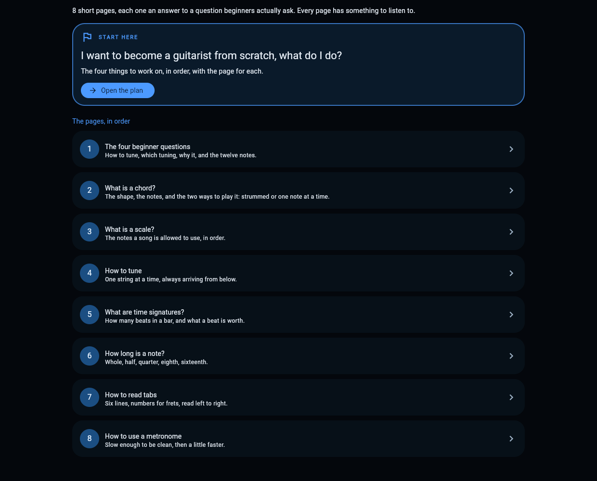
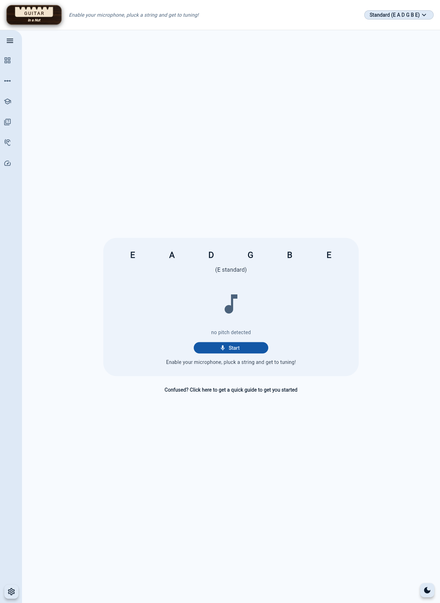
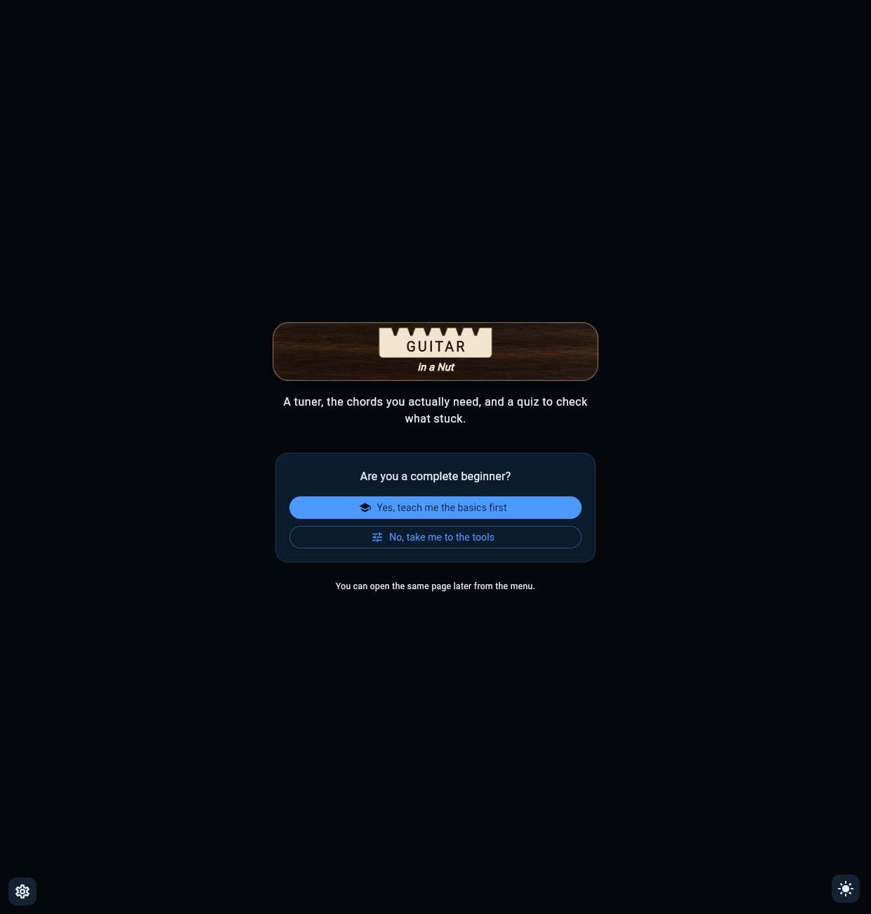
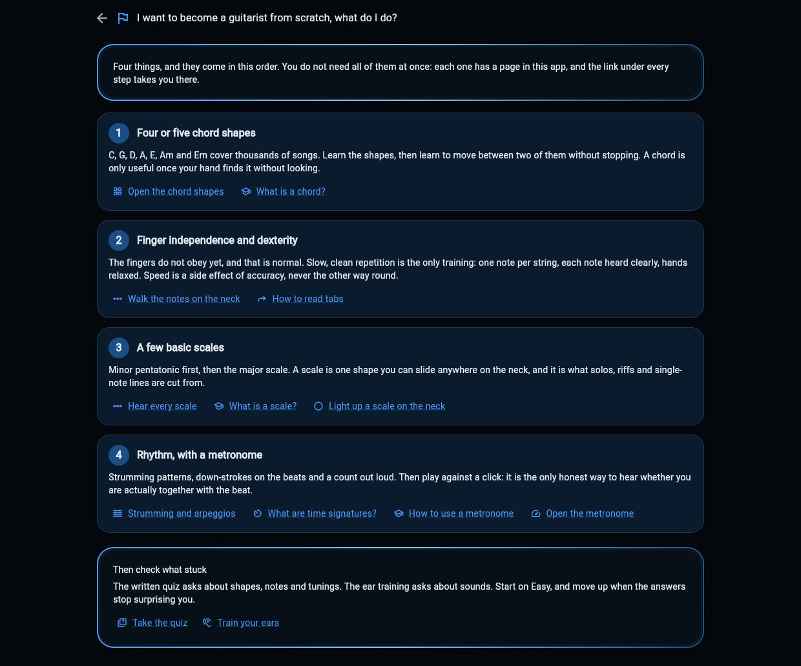
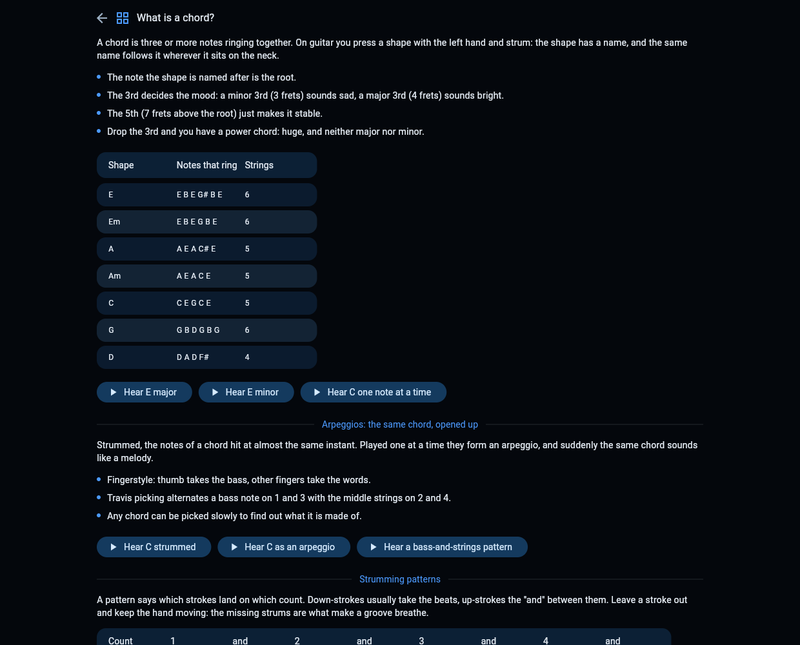

# Guitar-in-a-Nut

A beginner's practice companion for the acoustic and electric guitar, built with **Flutter for the web**.
Tune with a live microphone pitch detector, learn chord shapes, read the fretboard, write a drum pattern, and test yourself.

School project — no account, no install, and nothing leaves your browser except the audio the tuner listens to.

## Screens

| Screen | What it does |
| --- | --- |
| **Tuner** | Real-time pitch detection from the microphone, with a cents needle and the target note for each string. |
| **Chords** | 33 chord shapes grouped by the key they fit in, drawn as fret diagrams and demoed against the chosen scale. |
| **Neck** | Every note of the fretboard, one tap away. Highlights the notes of 8 common scales from any root. |
| **Learn** | Short pages answering the questions beginners actually ask, led by a start-here banner that opens the from-scratch plan. |
| **Quiz** | Pick a level and a length: the round is drawn fresh from the questions that level allows, and Expert types the answer instead of picking one. |
| **Ear training** | No note names on screen — listen, guess, then read why you were right or wrong. Four modes, the same four levels, and a round of 5 to 20 sounds. |
| **Metronome** | Set the tempo, count the bar, choose the click sound: kick, tom, snare, cymbal, bell, clap, cowbell and the three hi-hats are real recordings — the drum set cuts, the two cymbals left to ring — and the stick stays synthesised. Beat one can be stressed, louder and a touch higher, or switched off for an even tick. The beats are booked on the browser's audio clock, so a lagging frame cannot push the click off the beat. |
| **Drum machine** | The same eleven voices as lanes on a grid of sixteen steps — one bar of sixteenth notes. Tap the cells to write a pattern, press Play and it loops on the audio clock while you keep editing it. Add a bar to write a second one, copy or delete what you have, and Play runs the bars in order: the cards above the grid show where each bar's hits fall and which one is sounding. Three starter patterns, and the page opens with the rock beat already written. |
| **From scratch** | The plan a total beginner follows: four things, in order, each with the page that teaches it. It sits on top of LEARN as a banner rather than as another menu entry. |
| **Theory** | Optional intro page for visitors who want the fundamentals first. |

## Interface

The app ships in **English and French** and in **dark and light** themes, both switchable from the settings button in the corner.
Only the interface is translated, and the French side is a machine pass nobody has proofread, so the settings sheet says so and points back at English.
The layout adapts from a phone to a wide desktop window: below 640 px the navigation rail collapses to icons and the tagline drops under the header.

| Home | Chords | Neck | Quiz |
| --- | --- | --- | --- |
|  |  |  |  |

| Ear training | Metronome | Drum machine | Learn |
| --- | --- | --- | --- |
|  |  |  |  |

| Light theme | Start | From scratch | Chord lesson |
| --- | --- | --- | --- |
|  |  |  |  |

| French | | | |
| --- | --- | --- | --- |
|  | | | |


## Tunings

Standard (E A D G B E), Drop D, Half step down, D standard, Drop C, DADGAD (modal), Open G (slide), Open D and Open E — 10 in total.
Every screen reacts: chord diagrams, the neck map and the tuner targets all follow the tuning picked in the header.

## Environment

| Requirement | Version used | Notes |
| --- | --- | --- |
| Flutter SDK | **3.47.9** (stable channel) | Provides the Dart SDK, the web tooling and `flutter run`. |
| Dart SDK | **3.13.7** | Bundled with Flutter — no separate install. The project requires `^3.13.7`. |
| Browser | Chrome or Edge | The app is developed and tested against these; `flutter run -d chrome` targets them directly. |
| Git | any recent | For cloning. |

The project targets **the web only**: `web/` is the sole platform folder, and there is no `android/` or `ios/` directory.
The tuner streams audio through the browser, so the app must be served over `https://` or `localhost` for the microphone to be granted.

Verify your setup before running anything:

```bash
flutter --version    # expect Flutter 3.47.x / Dart 3.13.x or newer
flutter doctor       # the "Chrome - web" line must be checked
```

If the web target is missing from `flutter doctor`, enable it once:

```bash
flutter config --enable-web
flutter precache --web
```

## Getting started

```bash
git clone https://github.com/malikbssb/Guitar-in-a-Nut.git
cd Guitar-in-a-Nut
flutter pub get
flutter run -d chrome
```

Prefer a local folder that already exists? Clone into it with a name of your choice:

```bash
git clone https://github.com/malikbssb/Guitar-in-a-Nut.git my-folder
```

The tuner asks for microphone access on first use.


## Checks and build

```bash
flutter analyze
flutter test
flutter build web --release
```

The output of `flutter build web` is a static site that can be hosted anywhere.

## Project layout

```
assets/
  clicks/                the ten recorded drum voices, 9–88 KB
lib/
  main.dart              theme, app root, intro and theory entry
  app_shell.dart         header, navigation rail, section switching
  audio/                 plucked-string audio, the metronome and drum-machine Web Audio clocks (web + stub)
  chords/                chord list screen
  drum/                  the step-sequencer grid, the bars of a song and its three starter patterns
  l10n/                  English and French strings
  learn/                 beginner lessons
  metronome/             the click screen: tempo, bar length, voice chips
  models/                notes, tunings, chords, scales
  neck/                  fretboard map with scale highlighting
  quiz/                  quiz and ear-training screens, data and difficulty levels
  roadmap/               the from-scratch plan, opened from the LEARN banner
  start/                 the beginner-or-not entry screen
  tuner/                 microphone pitch detector and tuner screen
  widgets/               nav rail, its drawn snare, metronome and neck glyphs, chord diagram, settings and theme buttons
shots/                   screenshots used above
test/                    widget tests
tool/                    audio_input.dart reads a WAV or AIFF one-shot,
                         trim_clicks.dart cuts it to a click,
                         probe_click.dart measures a new sample before it is named
```

`lib/preview.dart` and `serve_preview.dart` are development-only helpers that render a single screen headlessly so the `shots/` screenshots can be captured; they are not part of the app.

## Stack

Flutter 3.47 (stable) on Dart 3.13.7, with `record` ^7.1.2 for microphone capture, `web` ^1.1.1 for the browser APIs and `flutter_lints` ^6.0.0 for the analysis rules. No backend, no analytics.
