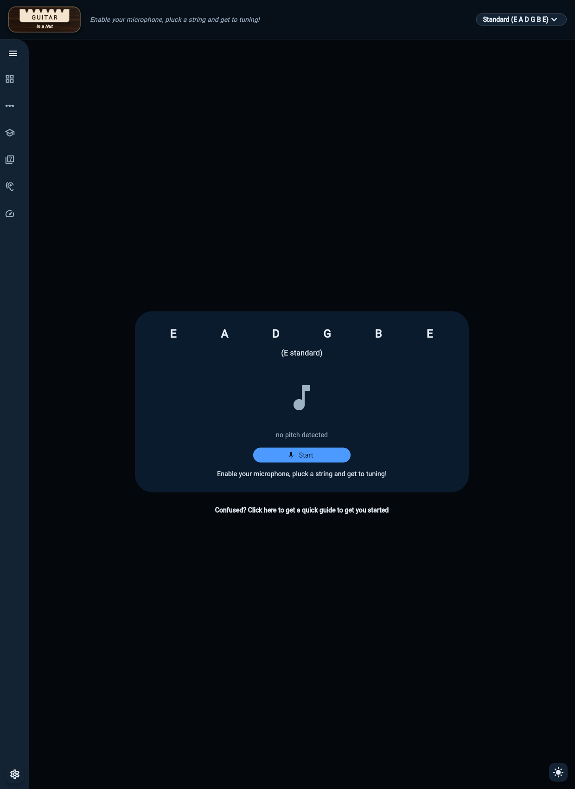
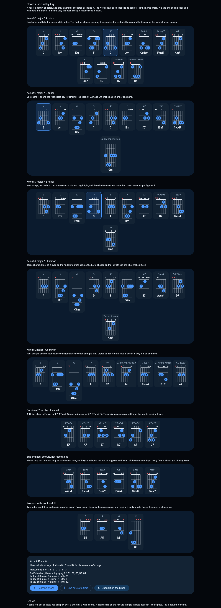
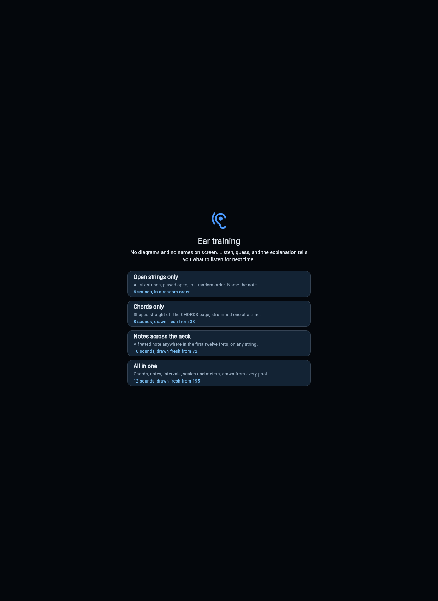

# Guitar-in-a-Nut

A beginner's practice companion for the acoustic and electric guitar, built with **Flutter for the web**.
Tune with a live microphone pitch detector, learn chord shapes, read the fretboard, and test yourself.

School project — no account, no install, and nothing leaves your browser except the audio the tuner listens to.

## Screens

| Screen | What it does |
| --- | --- |
| **Tuner** | Real-time pitch detection from the microphone, with a cents needle and the target note for each string. |
| **Chords** | 34 chord shapes grouped by the key they fit in, drawn as fret diagrams and demoed against the chosen scale. |
| **Neck** | Every note of the fretboard, one tap away. Highlights the notes of 8 common scales from any root. |
| **Learn** | Short pages answering the questions beginners actually ask, linked from the tuner guide. |
| **Quiz** | Ten questions drawn at random from a larger pool; a new draw every round. |
| **Ear training** | No note names on screen — listen, guess, then read why you were right or wrong. |
| **Metronome** | Set the tempo, count the bar, choose the click sound. |
| **Theory** | Optional intro page for visitors who want the fundamentals first. |

## Interface

The app ships in **English and French** and in **dark and light** themes, both switchable from the settings button in the corner.
The layout adapts from a phone to a wide desktop window: below 640 px the navigation rail collapses to icons and the tagline drops under the header.

| Home | Chords | Neck | Quiz |
| --- | --- | --- | --- |
|  |  |  |  |

| Ear training | Metronome | Learn | Light theme |
| --- | --- | --- | --- |
|  |  |  |  |

## Tunings

Standard (E A D G B E), Drop D, Half step down, D standard, Drop C, DADGAD (modal), Open G (slide), Open D and Open E — 10 in total.
Every screen reacts: chord diagrams, the neck map and the tuner targets all follow the tuning picked in the header.

## Getting started

```bash
flutter pub get
flutter run -d chrome
```

The tuner asks for microphone access on first use. Browsers only grant it over `https://` or `localhost`.

## Checks and build

```bash
flutter analyze
flutter test
flutter build web --release
```

The output of `flutter build web` is a static site that can be hosted anywhere.

## Project layout

```
lib/
  main.dart              theme, app root, intro and theory entry
  app_shell.dart         header, navigation rail, section switching
  audio/                 click synthesis and plucked-string audio (web + stub)
  chords/                chord list screen
  l10n/                  English and French strings
  learn/                 beginner lessons
  metronome/             tempo and time-signature click
  models/                notes, tunings, chords, scales
  neck/                  fretboard map with scale highlighting
  quiz/                  quiz and ear-training screens and data
  tuner/                 microphone pitch detector and tuner screen
  widgets/               nav rail, chord diagram, settings and theme buttons
shots/                   screenshots used above
test/                    widget tests
```

`lib/preview.dart` and `serve_preview.dart` are development-only helpers that render a single screen headlessly so the `shots/` screenshots can be captured; they are not part of the app.

## Stack

Flutter with Dart `^3.13.7`, `record` for microphone capture, `web` for the browser APIs, `flutter_lints` for analysis rules. No backend, no analytics.
